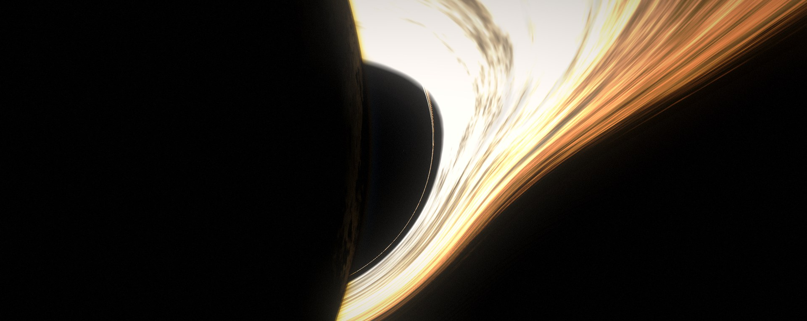
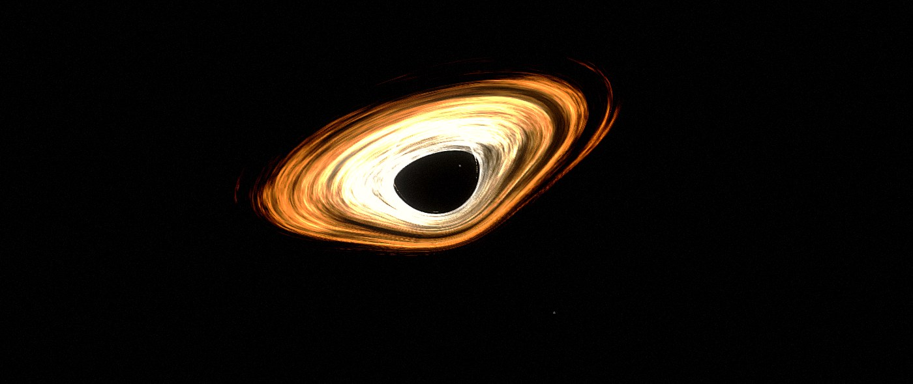
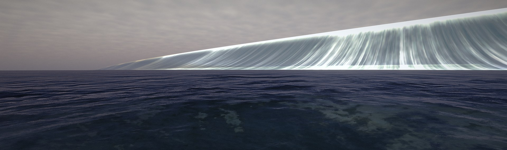
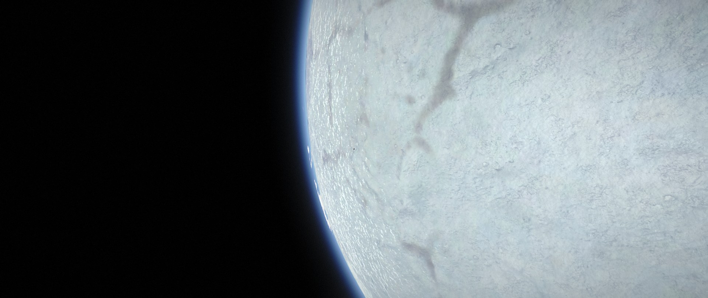
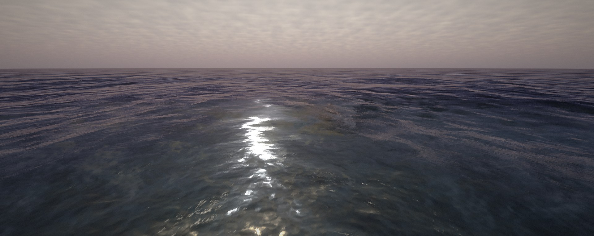
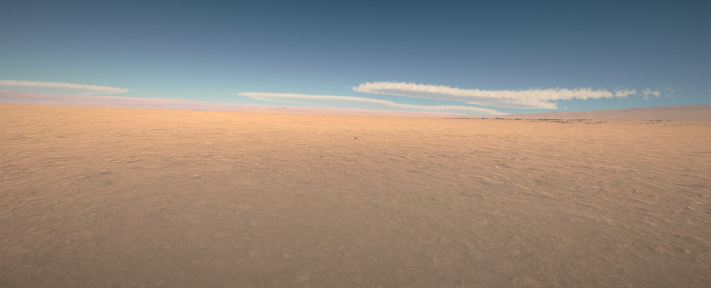
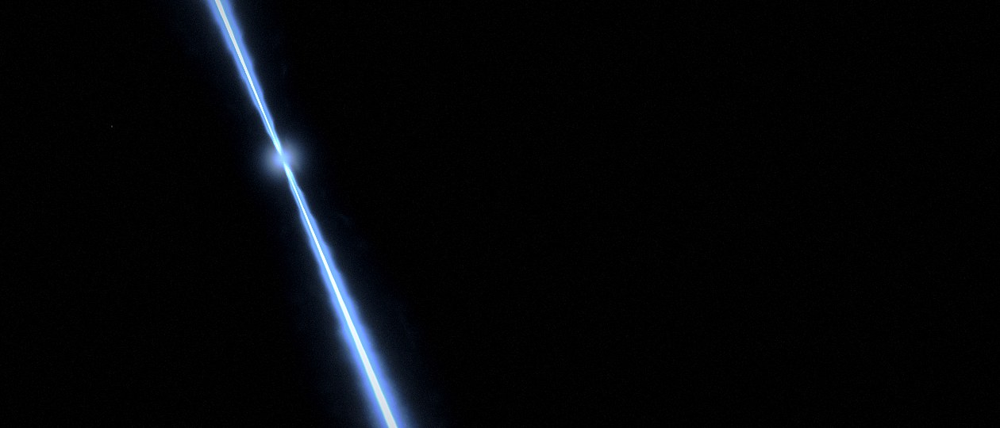

  

<h1 align="center">Gargantua System</h1>

  <em>"It´s not possible... no, it's necessary."</em> 
  An <b>Interstellar</b>-inspired planet pack for <b>Kerbal Space Program</b>

  
  
  
  

Fly through a wormhole near Jool and arrive at **Gargantua**: a supermassive black hole whose light bends around its
event horizon, wrapped in a blazing accretion disk. Splash down on **Miller**, a knee-deep ocean world swept by
kilometre-high tidal waves, walk the crumpled glaciers of **Mann**, and settle on **Edmunds**, the dry, breathable
world warmed by the star **Pantagruel**. A spinning **pulsar** lights the dark with its jets.

## Gallery

| | |
|:---:|:---:|
|  |  |
| **Gargantua**, from Mann's orbit | **Miller**: Tsunami |
|  |  |
| **Mann**| **Miller** |
|  |  |
| **Edmunds** | **The pulsar** |

All images are in-game screenshots (UI hidden), lightly colour graded.

## Features

- **Gargantua** — gravitational lensing and a tilted, lensed accretion disk (Singularity).
- **Miller's giant waves** — five 1.2 km tidal waves sweep the planet. Floating vessels and Kerbals are lifted,
  carried and set down again, and time warp stops with a warning before a crest arrives.
- **Detailed worlds** — 16-bit heightmaps, an 8K colour map on Mann, Parallax terrain and 3D rocks, Scatterer
  atmospheres and Miller's ocean, EVE clouds (volumetric with blackrack's clouds).
- **A real pulsar** — glowing neutron star with animated jets that does not steal your lighting.
- **Optional wormhole** — Kerbol side near Jool (Sarnus with OPM, Saturn with RSS/KSRSS) to Gargantua.
- **Settings** — wormhole on/off, Kerbol–Gargantua distance, skybox on/off.
- **Movie quotes** — a few references hidden in the game texts, in English and Brazilian Portuguese.

## Celestial bodies

| Body | Quick Description |
|---|---|
| Gargantua | Supermassive black hole |
| Miller | Shallow ocean world, tidally locked, giant tidal waves |
| Mann | Glacier world, thin cold atmosphere |
| Edmunds | Rocky desert with breathable air, no ocean (the last planet in the movie) |
| Pantagruel | Star that lights Edmunds |
| Neutron star | Unnamed pulsar from the film, with jets |
| Wormhole A / B | Kerbol side (Jool in stock; Sarnus with OPM; Saturn with RSS/KSRSS) ↔ Gargantua side. Optional (`Wormholes = True`) |

## Dependencies

Required (CKAN installs them all): **Kopernicus**, **ModuleManager**, **Singularity**, **KopernicusExpansion
Continued-er** (wormhole and 16-bit heightmaps), **Scatterer** (atmospheres and Miller's ocean), **EVE** (clouds),
**Parallax Continued** with its stock terrain and scatter textures (terrain detail and rocks on Mann and Edmunds) and
**SigmaReplacements-SkyBox** (skybox). Harmony comes with Kopernicus.

Recommended (not on CKAN, install by hand): blackrack's raymarched volumetric clouds for EVE (V3 and V4 are free) with
the **StockVolumetricClouds** pack. With it, Miller, Mann and Edmunds get volumetric cloud decks that give them an extra
charm.

Tested on: KSP 1.12.5, Kopernicus release-247, Singularity 0.994, ModuleManager 4.2.3, KopernicusExpansion
Continued-er Beta9.1.1, Scatterer 0.0878, EVE (raymarched, StockVolumetricClouds V4), Parallax Continued,
Deferred 1.3.5. Also tested with Outer Planets Mod and Real Solar System 20.1.3.

## Install

1. **Back up your save first.**
2. Install with **CKAN** (when published), or download the zip from
   [Releases](https://github.com/XiruTheRealBoss/GargantuaSystem-KSP/releases/latest) and copy `GameData/GargantuaSystem`
   into your KSP `GameData` folder, together with the dependencies above.
3. Recommended: in `GameData/scatterer/config/config.cfg` set `useTemporalAntiAliasing = False` (see Known issues).

## Settings

**Only edit with the game closed, to keep your save from corrupting and celestial bodies from disappearing.**

Edit `GameData/GargantuaSystem/GargantuaSystem_Settings.cfg`:

- `Wormholes` (True/False): the Kerbol ↔ Gargantua wormhole.
- `DistanceFactor` (1, 0.1, 10, 100): Kerbol–Gargantua distance. `0` makes Kerbol orbit Gargantua (experimental).
- `DisableSkybox` (True/False): turns off the custom skybox.

## Compatibility

- **Principia:** forces `DistanceFactor = 0`, no wormholes and a black skybox (Singularity artifacts otherwise).
  *Untested.*
- **RSS:** tested with Real Solar System 20.1.3 (CKAN). Gargantua's bodies survive RSS's cleanup, the Sun-side
  wormhole moves to Saturn and distances scale ×10. RSS Reborn (installed with its own installer) is not supported.
- **KSRSS:** same patches as RSS. *Untested.*
- **OPM:** tested. The Kerbol-side wormhole moves to Sarnus.
- **KerbalGalaxy 3:** incompatible (it also adds a body named `Gargantua`).

## Known issues

- **Torn or frozen sky near Gargantua:** Scatterer's TAA together with Singularity smears the sky. Set
  `useTemporalAntiAliasing = False` in `GameData/scatterer/config/config.cfg` (SMAA keeps working).
- **Faint circle around Gargantua:** Singularity only draws the black hole inside a sphere (here 5.4E10 m). Inside it
  the sky comes from a galaxy snapshot, so its brightness can differ slightly from the sky outside.
- Pulsar jets disappear when seen *through* that sphere (behind Gargantua).
- Miller's waves only move vessels that are loaded and unpacked. Vessels in time warp or far away are not swept.
  The game drops time warp and warns ("Those aren't mountains... they're waves!") when a crest is 33 km away.
- Miller's night side is very dark.
- After a wormhole jump the vessel exits inside the jump zone of the other mouth: fly out before saving.
- Singularity may crash when switching to a far-away vessel (Singularity #11, with Scatterer), and with Principia
  shows artifacts on one side (Singularity #4).
- Interstellar distances: disable part heating for the long cruise if it misbehaves.

Found a bug? [Open an issue](https://github.com/XiruTheRealBoss/GargantuaSystem-KSP/issues/new/choose) and attach
your `KSP.log`.

## Creative liberties (vs. the film and real physics)

- **Scale:** Gargantua is 1.0E30 kg (the film's is ≥ 10⁸ solar masses). The real mass makes orbits near the horizon
  relativistic and unplayable. The disk outer radius is limited to 2.2E10 m (Singularity breaks above ~3E10 m).
- No time dilation (1 hour on Miller = 7 years in the film).
- Miller's 1.3 g, the planets' radii, orbits and terrain details are invented to be playable and to look like
  the film. Miller's waves: 1200 m crests at 100 m/s, analytic buoyancy (not a fluid simulation).
- Pantagruel as Edmunds' star and the pulsar's jets/orbit are not from the film.

## Building

- Textures: `uv run tools/gen_textures.py`, `uv run tools/gen_planets.py`, `uv run tools/gen_clouds.py`,
  `uv run tools/gen_skybox.py`.
- Plugin (waves + pulsar jets): `dotnet build -c Release` in `src/GargantuaWaves` (net472; set `-p:KSPDIR=...`).

## Credits

- **Singularity**, **Scatterer** and the raymarched **EVE** clouds by blackrack (LGhassen).
- **Kopernicus** by the Kopernicus team, **KopernicusExpansion Continued-er** by VabienArt, **Parallax Continued** by
  Gameslinx, **ModuleManager** by sarbian.
- Inspired by Christopher Nolan's *Interstellar* (2014). This is an unofficial fan mod.

## License

Code and configs: MIT. Textures (all generated by the scripts in `tools/`): CC-BY-4.0. See [LICENSE](LICENSE).
No files from Kcalbeloh, Cosmic Serenity or KerbalGalaxy are included.
